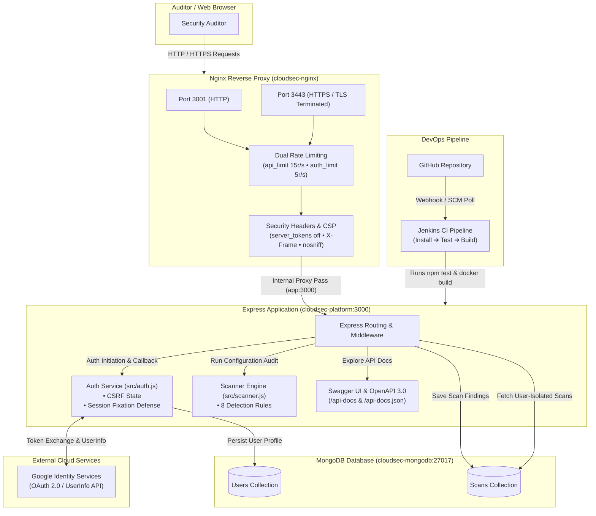
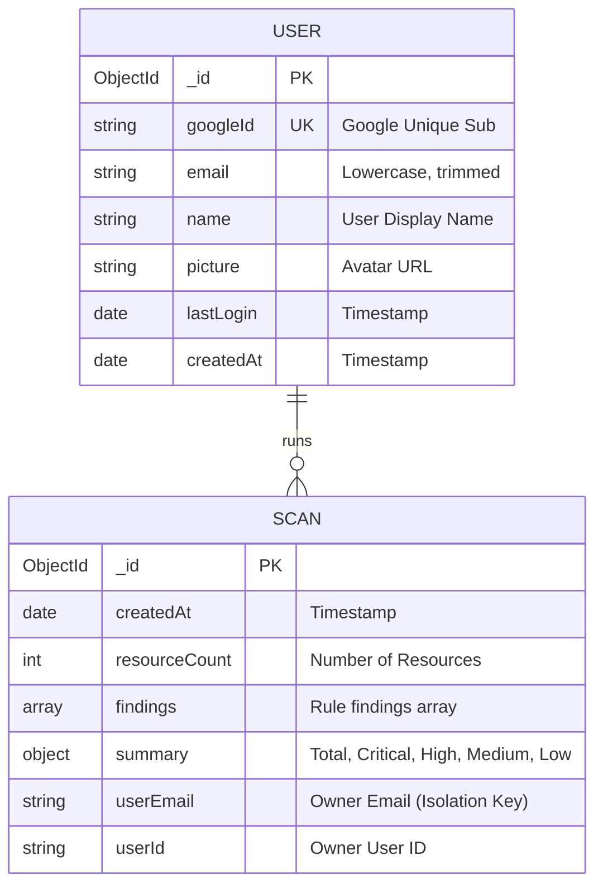

# Cloud Security Misconfiguration Detection Platform

**Academic Capstone Project — Final Technical Documentation**

**Project Team:**
- Gangana Bharath Simha Reddy — BT23GCS494
- Garre Lakhmi Narayana — BT23GCS253
- Charugundla Hemendra Venkata Lalith — BT23GCS254

**Repository:** [github.com/bharathreddy1924/cloud-security-misconfiguration-platform](https://github.com/bharathreddy1924/cloud-security-misconfiguration-platform)  
**Primary Language & Framework:** JavaScript (Node.js 22 LTS, Express.js 4)  
**Database:** MongoDB 7  
**Gateway & Transport:** Nginx Alpine (Dual HTTP/HTTPS Reverse Proxy)  
**Authentication:** Google OAuth 2.0 (OpenID Connect) with CSRF Protection & Session Fixation Mitigation  

---

## 1. Project Overview

The **Cloud Security Misconfiguration Detection Platform** is a defensive, rule-based auditing platform designed to detect security misconfigurations in cloud infrastructure resource definitions before they can be exploited. 

Cloud environments frequently suffer data breaches not from sophisticated zero-day exploits, but from basic configuration oversights: publicly exposed storage buckets, unrestricted administrative ports, over-privileged IAM policies, unencrypted data at rest, and unmonitored logging trails. 

This platform evaluates cloud resource configuration inventories against **eight defensive security rules**, identifies high-risk vulnerabilities, and generates contextual, prioritized remediation instructions. It incorporates:
- **Google OAuth 2.0 Authentication:** Secure identity verification with CSRF state protection.
- **Defensive Rule Engine:** Real-time evaluation of resource metadata with severity categorization.
- **Audit Trail & Persistence:** MongoDB history tracking scans attributed to authenticated users.
- **Interactive UI Dashboard & Scan History:** Professional posture analytics and personal historical scan records.
- **Dual HTTP & HTTPS Reverse Proxy:** Production-ready Nginx gateway with rate limiting and security headers.
- **OpenAPI 3.0 / Swagger Documentation:** Live interactive API specification at `/api-docs`.
- **Comprehensive Quality Assurance:** 48 automated Node.js unit/integration tests and 5 Selenium browser end-to-end tests.

> **Scope Note:** This platform evaluates supplied JSON resource configuration inventories. It does not connect to live AWS, Azure, or GCP accounts, require cloud root credentials, or alter live cloud infrastructure. This makes the platform safe for academic assessment, offline security audits, and continuous integration pipelines.

---

## 2. Problem Statement

According to industry security research (including Gartner and the NSA/CISA Cloud Security Technical Reports), over **99% of cloud security failures through 2025 are predicted to result from customer misconfigurations and human error** rather than vulnerabilities in the cloud provider's underlying hardware or hypervisor.

Common misconfiguration risks include:
1. **Public Object Storage Exposure:** Unrestricted Amazon S3 bucket permissions allow unauthorized internet users to download sensitive intellectual property, personally identifiable information (PII), or database backups.
2. **Missing Encryption at Rest:** Unencrypted S3 buckets and EBS volumes fail compliance standards (e.g., PCI-DSS, HIPAA, GDPR) and expose data if underlying physical storage media is compromised.
3. **Exposed Administrative Services:** Security Groups with SSH (port 22) or RDP (port 3389) open to `0.0.0.0/0` are constantly targeted by automated botnets conducting credential stuffing and brute-force attacks.
4. **Excessive IAM Permissions:** Wildcard permissions (`*` in Action or Resource) violate the principle of least privilege, enabling compromised credentials to escalate privileges and access the entire cloud estate.
5. **Internet-Facing Databases:** Database instances (RDS, MongoDB, PostgreSQL) exposed to the public internet invite direct denial-of-service attacks, automated credential spraying, and ransomware extortion.
6. **Disabled Audit Logging:** Inactive audit trails (CloudTrail) blind incident response teams, preventing forensic analysis during and after a security compromise.

Security teams require lightweight, transparent, and reproducible tools that can analyze configuration inventories during pre-deployment audits or continuous integration without risking live cloud downtime or sharing sensitive cloud management keys.

---

## 3. Project Objectives

1. **Defensive Rule-Based Detection Engine:** Implement an automated, deterministic scanning engine capable of evaluating infrastructure metadata against 8 AWS-style security checks.
2. **Identity & Access Management:** Implement single sign-on (SSO) using Google OAuth 2.0 with cryptographic state validation and session fixation prevention.
3. **Audit Trail & Historical Tracking:** Persist all scan records, findings, and severity breakdowns to MongoDB, providing users with a private, user-isolated scan history.
4. **Defense-in-Depth Gateway Architecture:** Deploy an Nginx reverse proxy providing dual HTTP (`:3001`) and TLS-encrypted HTTPS (`:3443`) endpoints with rate limiting and security headers.
5. **Interactive API Documentation:** Document all REST endpoints and data models using OpenAPI 3.0 / Swagger UI with live "Try it out" testing capability.
6. **Automated Testing & CI/CD Pipeline:** Validate system functionality with 48 Node.js tests, 5 Selenium browser automation tests, zero security vulnerabilities (`npm audit`), and a declarative Jenkins CI pipeline.

---

## 4. Key Features

- **8 Automated Detection Rules:** Covers S3 public access, S3 encryption, open SSH (port 22), open RDP (port 3389), wildcard IAM policies, public databases, disabled CloudTrail, and unencrypted EBS volumes.
- **Severity-Based Triage:** Classifies findings into `CRITICAL`, `HIGH`, `MEDIUM`, and `LOW` severities with clear contextual remediation instructions.
- **Google OAuth 2.0 Sign-In:** Secure authentication using Google Identity Services with verified email validation and CSRF protection.
- **User-Isolated Scan History:** MongoDB audit log displays recent assessments, resource counts, findings, and compliance badges for the logged-in user only.
- **Interactive OpenAPI Documentation:** Fully documented API schema at `/api-docs` with cookie-based authorization.
- **Production Security Hardening:** Suppressed server tokens (`server_tokens off;`), disabled framework fingerprinting (`app.disable('x-powered-by')`), Content Security Policy (CSP), and dual-zone rate limiting.
- **Dual Gateway Entrypoints:** Access via standard HTTP (`http://localhost:3001`) or TLS-encrypted HTTPS (`https://localhost:3443`).
- **Selenium Browser Automation:** End-to-end browser tests verifying UI rendering, buttons, and route guards using Selenium WebDriver in headless Chrome.

---

## 5. Technology Stack

| Layer / Role | Technology | Version | Purpose & Implementation Location |
|---|---|---|---|
| **Runtime Environment** | Node.js | v20+ / v22 LTS | JavaScript server-side execution runtime (`server.js`, `src/`) |
| **Web Application Framework** | Express.js | 4.21.2 | HTTP routing, middleware pipeline, REST API endpoints (`server.js`) |
| **Database** | MongoDB | 7.0 | Document database persisting user profiles and scan records (`mongo` container) |
| **Object Data Modeling (ODM)** | Mongoose | 8.9.5 | Schema definition, data validation, and query interface (`src/auth.js`, `server.js`) |
| **Identity Provider** | Google OAuth 2.0 | OpenID Connect | User authentication, identity verification, avatar retrieval (`src/auth.js`) |
| **Session Management** | express-session | 1.19.0 | Server-side cookie session management with session regeneration (`server.js`) |
| **API Documentation** | Swagger / OpenAPI | 3.0.0 | Interactive API documentation via `swagger-jsdoc` and `swagger-ui-express` (`/api-docs`) |
| **Reverse Proxy & TLS** | Nginx | Alpine | Reverse proxy, TLS termination, rate limiting, and security headers (`nginx/nginx.conf`) |
| **Containerization** | Docker & Docker Compose | Compose v2 | Multi-container orchestration for Nginx, Express, and MongoDB (`docker-compose.yml`) |
| **Continuous Integration** | Jenkins | Declarative Pipeline | Automated build, test execution, and container packaging (`Jenkinsfile`) |
| **Unit & Integration Testing** | Node.js Test Runner | `node:test`, `assert` | Built-in test runner executing 48 automated test cases (`test/`) |
| **End-to-End Browser Testing** | Selenium WebDriver | 4.51.0 | Browser automation testing using Chrome and Selenium Manager (`e2e/login.e2e.js`) |
| **Cryptography** | Node.js `crypto` / OpenSSL | Built-in | CSRF state generation, local TLS development certificate creation (`scripts/`) |

---

## 6. System Architecture



### Architectural Data Flow:
1. **Entrypoint:** All client traffic enters through Nginx on port `3001` (HTTP) or port `3443` (HTTPS).
2. **Gateway Hardening:** Nginx applies rate limiting (429 status on burst overflow), injects Content Security Policy and frame protection headers, and forwards traffic to the internal Express container (`app:3000`).
3. **Authentication:** Unauthenticated visitors to `/` or `/api/*` are intercepted. The user initiates Google OAuth, which generates a cryptographic state token stored in the session.
4. **Google Identity Verification:** Google exchanges authorization codes for ID tokens and verified profile data. Express regenerates the session ID to prevent fixation and stores user metadata in MongoDB.
5. **Rule Evaluation:** Authenticated users submit resource inventories. The scanner synchronously executes 8 defensive rules and returns findings with remediation guidance.
6. **Persistence & Isolation:** Scan results are persisted to the MongoDB `scans` collection with user attribution (`userEmail`, `userId`). The Scan History API queries only records belonging to the authenticated session.

---

## 7. Application Modules

### 1. Presentation Layer (`public/`)
- `login.html`: Branded sign-in portal featuring Google OAuth sign-in button, platform capability highlights, and OAuth protocol badges.
- `index.html`: Responsive dashboard displaying security posture metrics (Resources Scanned, Total Findings, Critical, High), JSON input area, findings display, and the Recent Scan History panel.
- `app.js`: Client-side logic for authentication checks (`initAuth`), scanning (`runScan`), finding card rendering (`renderFindings`), scan history loading (`loadScanHistory`), and dynamic refresh listeners.
- `styles.css`: Dark-mode interface styling (`#0b1020`) with severity color coding, metric card grids, and mobile-friendly responsive breakpoints (`@media(max-width:650px)`).

### 2. API & Routing Layer (`server.js`)
- Express routing for system health, Google OAuth endpoints, protected dashboard assets, Swagger UI documentation, and scanning endpoints.
- Global middleware: Express JSON parser (1MB limit), reverse proxy trust configuration (`trust proxy = 1`), dynamic session cookie handling (`COOKIE_SECURE=auto`), structured JSON 404 handler for `/api/*`, and centralized error handling middleware.

### 3. Authentication & Identity Service (`src/auth.js`)
- `isGoogleOAuthConfigured()`: Validates environment presence of Google credentials.
- `generateAuthUrl()`: Constructs Google consent URL with random 32-byte CSRF state parameter.
- `exchangeCodeForTokens()`: Exchanges one-time authorization code at Google's token endpoint.
- `fetchGoogleUserProfile()`: Retrieves verified name, email, and avatar from Google UserInfo.
- `persistUser()`: Upserts verified Google profile to MongoDB `User` collection.
- `requireAuthApi()` & `requireAuthPage()`: Route guard middleware returning JSON 401s or 302 redirects.

### 4. Detection Engine (`src/scanner.js`)
- Standalone, zero-dependency scanning engine implementing `scanResources(resources)`.
- Evaluates resource definitions against the `RULES` array, capturing rule identifiers, titles, severities, contextual descriptions, and actionable remediations.
- Resilient parsing: non-array inputs throw a `TypeError`; invalid individual objects or missing optional properties are safely skipped without aborting the audit.

---

## 8. Cloud Misconfiguration Detection Rules

The scanner implements **8 defensive security rules** inspecting common cloud infrastructure resource types (`s3`, `security-group`, `iam-policy`, `database`, `cloudtrail`, `ebs`):

| Rule ID | Resource Type | Severity | Misconfiguration Condition | Recommended Remediation |
|---|---|---|---|---|
| `S3_PUBLIC_ACCESS` | `s3` | **CRITICAL** | `publicAccess === true` or `blockPublicAccess === false` | Enable all S3 Block Public Access settings and review bucket policies and ACLs. |
| `S3_ENCRYPTION_DISABLED` | `s3` | **HIGH** | `encryptionEnabled === false` | Enable default server-side encryption using SSE-S3 or an approved KMS key. |
| `OPEN_SSH` | `security-group` | **CRITICAL** | Ingress port 22 open to `0.0.0.0/0` or `::/0` | Restrict SSH to a trusted VPN, bastion host, or approved source CIDR. |
| `OPEN_RDP` | `security-group` | **CRITICAL** | Ingress port 3389 open to `0.0.0.0/0` or `::/0` | Restrict RDP to a trusted VPN or approved source CIDR. |
| `IAM_WILDCARD_POLICY` | `iam-policy` | **HIGH** | `action === '*'` or `resource === '*'` | Apply least privilege: specify only required actions and resource ARNs. |
| `DATABASE_PUBLIC` | `database` | **CRITICAL** | `publiclyAccessible === true` | Disable public accessibility and place the database in private subnets. |
| `CLOUDTRAIL_DISABLED` | `cloudtrail` | **MEDIUM** | `enabled === false` | Enable CloudTrail in all required regions and protect log integrity. |
| `EBS_ENCRYPTION_DISABLED` | `ebs` | **MEDIUM** | `encrypted === false` | Enable encryption by default and encrypt existing volumes during migration. |

---

## 9. Authentication and Security

### 1. Google OAuth 2.0 & CSRF State Defense
- Authentication uses the Authorization Code flow with Google Identity Services.
- When `/auth/google` is visited, a cryptographically strong 32-byte hexadecimal state token (`crypto.randomBytes(32).toString('hex')`) is generated and saved in `req.session.oauthState`.
- Upon return to `/auth/google/callback`, the returned `state` parameter is strictly verified against the session state. It is deleted immediately upon verification to enforce single-use protection.

### 2. Session Fixation Mitigation
- Pre-authentication session IDs are invalidated upon successful authentication.
- In `/auth/google/callback`, `req.session.regenerate()` is executed before user profile attributes are assigned, guaranteeing that session tokens cannot be pre-fixed by an adversary.

### 3. Production Secret Validation (`validateSessionSecret`)
- During server startup in `NODE_ENV=production`, `server.js` evaluates `SESSION_SECRET`.
- If the secret is missing, shorter than 16 characters, or matches known default test strings (`cloudsec-dev-session-secret-change-in-production`, `secret`, `keyboard cat`, `changeme`), the server aborts startup immediately with a fatal error.
- Non-production environments (`development`, `test`) fall back to default secrets for developer convenience.

### 4. Adaptive Cookie Security (`COOKIE_SECURE=auto`)
- The session cookie (`cloudsec.sid`) is configured with `httpOnly: true` (preventing client-side JavaScript access) and `sameSite: 'lax'` (CSRF mitigation).
- `COOKIE_SECURE=auto` dynamically enforces the `Secure` attribute when requests arrive over HTTPS (via `X-Forwarded-Proto` and Express proxy trust) while maintaining HTTP development compatibility.

### 5. HTTP Security Headers & Information Disclosure Suppression
- **`app.disable('x-powered-by')`:** Eliminates the `X-Powered-By: Express` header to prevent technology fingerprinting.
- **`server_tokens off;`:** Suppresses Nginx version numbers in the `Server: nginx` response header and default error pages.
- **`X-Content-Type-Options: nosniff`:** Prevents MIME-type sniffing.
- **`X-Frame-Options: SAMEORIGIN`:** Protects against clickjacking.
- **`Referrer-Policy: strict-origin-when-cross-origin`:** Controls referrer information sent with outbound requests.
- **`Content-Security-Policy`:** Scoped policy allowing application assets, Swagger UI inline scripts/styles, and Google profile avatars (`https://lh3.googleusercontent.com`).

### 6. Dual-Zone Rate Limiting
Nginx enforces request rate limiting using shared memory zones:
- **API Zone (`/api/`):** 15 requests per second with a burst buffer of 25 requests (`nodelay`).
- **Auth Zone (`/auth/`):** 5 requests per second with a burst buffer of 10 requests (`nodelay`) to prevent brute-force attacks.
- Returns HTTP **`429 Too Many Requests`** when thresholds are exceeded.

---

## 10. Database Design

The platform uses MongoDB 7 via Mongoose. The database stores two primary collections:



### 1. `User` Schema
- `googleId`: Unique string index representing the Google OAuth `sub` claim.
- `email`: Normalized lowercase user email address.
- `name` & `picture`: Display identity and Google avatar URL.
- `lastLogin` & `createdAt`: Audit timestamps.

### 2. `Scan` Schema
- `createdAt`: Date timestamp (defaults to `Date.now`), indexed for descending retrieval.
- `resourceCount`: Integer count of resources analyzed in the scan.
- `findings`: Array of finding objects (`ruleId`, `resourceId`, `resourceType`, `severity`, `description`, `remediation`).
- `summary`: Embedded document tracking severity totals: `{ total, critical, high, medium, low }`.
- `userEmail` & `userId`: Identity attribution linking the scan directly to the authenticated user for multi-tenant isolation.

---

## 11. REST API Documentation

### Public Endpoints

| Method | Endpoint | Description | Expected Response |
|---|---|---|---|
| `GET` | `/api/health` | Operational health check and database status | `200 OK` (JSON) |
| `GET` | `/api-docs` | Interactive Swagger UI documentation | `200 OK` (HTML) |
| `GET` | `/api-docs.json` | OpenAPI 3.0 specification definition | `200 OK` (JSON) |
| `GET` | `/login` | Serves the user authentication page | `200 OK` (HTML) |
| `GET` | `/auth/google` | Initiates Google OAuth consent flow with CSRF state | `302 Found` (Redirect to Google) |
| `GET` | `/auth/google/callback`| Receives auth code, verifies state, creates session | `302 Found` (Redirect to `/`) |
| `GET/POST`| `/auth/logout` | Terminates session and clears `cloudsec.sid` cookie | `302 Found` (Redirect to `/login`) |

### Protected Endpoints (Active Session Cookie Required)

| Method | Endpoint | Description | Expected Response |
|---|---|---|---|
| `GET` | `/` | Serves the security posture dashboard | `200 OK` (HTML) or `302` to `/login` |
| `GET` | `/api/auth/me` | Returns authenticated user profile metadata | `200 OK` (JSON) or `401 Unauthorized` |
| `POST` | `/api/scan` | Submits resource inventory for security evaluation | `200 OK` (JSON) or `400` / `401` |
| `GET` | `/api/scans` | Retrieves up to 20 recent scans for current user | `200 OK` (JSON) or `401` / `503` |

### Sample Scan Request (`POST /api/scan`)
```bash
curl -X POST http://localhost:3001/api/scan \
  -H "Content-Type: application/json" \
  -H "Cookie: cloudsec.sid=s%3A..." \
  -d '{
    "resources": [
      { "id": "prod-bucket", "type": "s3", "publicAccess": true, "encryptionEnabled": false },
      { "id": "sg-ssh", "type": "security-group", "ingress": [{ "port": 22, "cidr": "0.0.0.0/0" }] },
      { "id": "iam-admin", "type": "iam-policy", "action": "*", "resource": "*" },
      { "id": "prod-db", "type": "database", "publiclyAccessible": true },
      { "id": "trail-main", "type": "cloudtrail", "enabled": false },
      { "id": "vol-01", "type": "ebs", "encrypted": true }
    ]
  }'
```

### Sample Scan Response (`200 OK`)
```json
{
  "scanId": "6741dfa9b984fa001234abcd",
  "resourceCount": 6,
  "summary": {
    "total": 5,
    "critical": 3,
    "high": 2,
    "medium": 0,
    "low": 0
  },
  "findings": [
    {
      "ruleId": "S3_PUBLIC_ACCESS",
      "resourceId": "prod-bucket",
      "resourceType": "s3",
      "title": "S3 bucket allows public access",
      "severity": "CRITICAL",
      "description": "Public bucket access can expose stored data to unauthorised users.",
      "remediation": "Enable all S3 Block Public Access settings and review bucket policies and ACLs."
    }
  ],
  "persistence": "saved"
}
```

---

## 12. DevOps and CI/CD Implementation

The project includes an automated continuous integration pipeline configured in `Jenkinsfile`.

```text
Jenkins Pipeline Flow:
[Checkout SCM] ➔ [Install Dependencies (npm ci)] ➔ [Run Tests (npm test)] ➔ [Build Docker Image]
```

### Pipeline Stages (`Jenkinsfile`):
1. **Checkout:** Clones the repository and checks out the target Git commit.
2. **Install Dependencies:** Executes `npm ci --no-audit --no-fund` to install production and development dependencies deterministically from `package-lock.json`.
3. **Unit Tests:** Executes `npm test`, asserting that all 48 automated tests pass. If any test fails, the build halts.
4. **Build Docker Image:** Builds the container image `cloudsec-platform:${BUILD_NUMBER}` from `Dockerfile`.

---

## 13. Docker and Nginx Architecture

The application runs as a multi-container system orchestrated with **Docker Compose**:

- **`cloudsec-nginx` (Nginx Alpine):**
  - Ports: `3001:80` (HTTP), `3443:443` (HTTPS).
  - Terminating reverse proxy applying TLS, CSP headers, and rate limiting.
  - Passes traffic to `app_backend` (`http://app:3000`).
- **`cloudsec-platform` (Node.js 22 Alpine):**
  - Port `3000` (internal Docker network only, unmapped to host).
  - Non-root user execution (`USER node`).
  - Production environment mode (`NODE_ENV=production`).
- **`cloudsec-mongodb` (Mongo 7.0):**
  - Port `27017` (internal network).
  - Data persisted via named volume `mongo_data`.
  - Configured with built-in healthchecks using `mongosh ping`.

---

## 14. HTTPS Configuration

Local HTTPS is enabled through an automated TLS generator and Nginx configuration:

### 1. Development Certificate Generation
Generate self-signed development certificates with Subject Alternative Names (SAN) for `localhost` and `127.0.0.1`:
```bash
node scripts/generate-dev-certs.js
```
This generates:
- `nginx/certs/cloudsec.crt` (X.509 Certificate)
- `nginx/certs/cloudsec.key` (2048-bit RSA Private Key)

### 2. Modern TLS Directives (`nginx/nginx.conf`)
- Supported Protocols: `TLSv1.2 TLSv1.3`
- Cipher Suite: `HIGH:!aNULL:!MD5:!3DES`
- Session Cache: Shared 10MB cache with 1-day timeout (`ssl_session_cache shared:SSL:10m;`)
- Verification via curl:
  ```bash
  curl.exe --cacert nginx/certs/cloudsec.crt https://localhost:3443/api/health
  ```

---

## 15. Installation and Setup

### Prerequisites
- Node.js 20 LTS or higher, with `npm`
- Docker and Docker Compose (for containerized deployment)
- Google Cloud Console project (for live Google Sign-In)

### Method A: Running with Docker Compose (Recommended)

1. **Clone the repository:**
   ```bash
   git clone https://github.com/bharathreddy1924/cloud-security-misconfiguration-platform.git
   cd cloud-security-misconfiguration-platform
   ```

2. **Generate development TLS certificates:**
   ```bash
   node scripts/generate-dev-certs.js
   ```

3. **Configure environment variables:**
   ```bash
   cp .env.example .env
   ```
   Edit `.env` and provide your Google OAuth credentials and a secure random `SESSION_SECRET` (minimum 16 characters).

4. **Build and launch containers:**
   ```bash
   docker compose up --build -d
   ```

5. **Verify container health:**
   ```bash
   docker compose ps
   ```

6. **Access the application:**
   - **HTTP:** [http://localhost:3001](http://localhost:3001)
   - **HTTPS:** [https://localhost:3443](https://localhost:3443)
   - **Swagger UI:** [https://localhost:3443/api-docs](https://localhost:3443/api-docs)

### Method B: Running Standalone Node.js (Without Docker)

1. **Install dependencies:**
   ```bash
   npm install
   ```
2. **Start the local server:**
   ```bash
   npm start
   ```
3. Open `http://localhost:3000` in your web browser.

---

## 16. Environment Configuration

Copy `.env.example` to `.env` and configure the following variables:

| Variable | Required | Description | Example / Default |
|---|---|---|---|
| `PORT` | Optional | Internal port Express listens on | `3000` |
| `NODE_ENV` | Required | Application runtime mode (`development`, `production`, `test`) | `development` |
| `MONGODB_URI` | Optional | MongoDB connection string (in-memory mode if omitted) | `mongodb://localhost:27017/cloudsec` |
| `SESSION_SECRET` | Required in Prod | Encryption key used to sign the session ID cookie | 32+ character random string |
| `COOKIE_SECURE` | Optional | Enforces `Secure` cookie flag (`false`, `true`, `auto`) | `auto` |
| `TRUST_PROXY` | Optional | Reverse proxy hop count (set `1` behind Nginx) | `1` |
| `GOOGLE_CLIENT_ID` | Optional | OAuth 2.0 Client ID from Google Cloud Console | `xxxx.apps.googleusercontent.com` |
| `GOOGLE_CLIENT_SECRET` | Optional | OAuth 2.0 Client Secret from Google Cloud Console | `GOCSPX-xxxx` |
| `GOOGLE_CALLBACK_URL` | Optional | OAuth callback redirect URL matching Google Console | `http://localhost:3001/auth/google/callback` |

---

## 17. Google Cloud Console Setup Guide

To enable live Google Sign-In with real Google accounts:

1. **Open Google Cloud Console:** Navigate to [console.cloud.google.com](https://console.cloud.google.com/).
2. **Configure Consent Screen:**
   - Go to **APIs & Services &rarr; OAuth consent screen**.
   - User Type: **External**.
   - Scopes: `openid`, `.../auth/userinfo.email`, `.../auth/userinfo.profile`.
   - Add your Google account email under **Test users**.
3. **Create OAuth Client ID:**
   - Go to **Credentials &rarr; Create Credentials &rarr; OAuth client ID**.
   - Application Type: **Web application**.
   - **Authorized JavaScript origins:**
     - `http://localhost:3001` (Docker Compose HTTP)
     - `https://localhost:3443` (Docker Compose HTTPS)
     - `http://localhost:3000` (Local Standalone Node)
   - **Authorized redirect URIs:**
     - `http://localhost:3001/auth/google/callback`
     - `https://localhost:3443/auth/google/callback`
     - `http://localhost:3000/auth/google/callback`
4. Copy your **Client ID** and **Client Secret** into your `.env` file.

---

## 18. Running Automated Tests

The testing suite validates backend logic, security controls, API contracts, database persistence, and browser UI rendering:

### 1. Unit & Integration Tests (Node.js Test Runner)
```bash
npm test
```
Executes **48 automated tests** across **8 test suites**:
- `test/scanner.test.js`: Validates all 8 detection rules and ensures zero false positives on compliant resources.
- `test/auth-unit.test.js`: Unit tests for CSRF token generation, parameter verification, and token exchange.
- `test/auth.test.js`: End-to-end integration tests for Google OAuth flow, session handling, route protection, and oversized payload rejection (>500 resources).
- `test/mongodb-history.test.js`: Tests user persistence and scan history persistence in MongoDB.
- `test/scan-history.test.js`: Tests user-specific scan history isolation, empty states, and offline database handling.
- `test/security-hardening.test.js`: Tests `X-Powered-By` suppression, strict production `SESSION_SECRET` validation, structured JSON 404 responses, and session fixation prevention.
- `test/nginx-gateway.test.js`: Automated verification of Nginx reverse proxy security headers, TLS configuration, rate limiting (HTTP 429), and proxy authorization.
- `test/swagger.test.js`: Asserts OpenAPI 3.0 schema validity and documentation completeness.

### 2. Selenium Browser Automation Tests
```bash
npm run test:e2e
```
Executes **5 browser-level end-to-end tests** using **Selenium WebDriver** (`selenium-webdriver`) with headless Google Chrome and automatic ChromeDriver lifecycle management via **Selenium Manager**:
- Validates login page visual layout, brand badges, and DOM structure.
- Verifies the **Continue with Google** button is visible, clickable, and linked to `/auth/google`.
- Verifies that unauthenticated requests to the dashboard root (`/`) are automatically redirected to `/login`.
- Asserts presence of security badges (OAuth 2.0, CSRF State Protection, HttpOnly Session).
- Authenticates a browser session using an active cookie, navigates to `/`, and verifies user profile rendering, the dashboard posture layout, and the Recent Scan History panel.

### 3. Dependency Security Audit
```bash
npm audit
```
Verifies that all installed dependencies contain **0 known vulnerabilities**.

---

## 19. Scan History Functionality

The **Recent Scan History** dashboard module provides authenticated auditors with full visibility into their previous assessments:

```text
Dashboard Workflow:
Google Login ➔ Dashboard ➔ Submit JSON ➔ Run Scan ➔ Save to MongoDB ➔ Auto-Refresh History ➔ View Previous Scans
```

- **User-Specific Isolation:** Scans are indexed by `userEmail` and `userId`. Auditors only see scans initiated by their own account.
- **Detailed Audit Metrics:** Each history card shows:
  - Formatted localized date and timestamp.
  - Number of resources assessed in the scan.
  - Compliance badge (`Compliant` or `Findings Detected`).
  - Total findings count.
  - Categorized severity count pills (`Critical`, `High`, `Medium`, `Low`).
- **Dynamic Background Refresh:** When a scan finishes, the history panel automatically refreshes in the background without a page reload.
- **Manual Refresh Control:** A dedicated `Refresh history` button allows manual queries at any time without creating duplicate database records.
- **Empty & Error States:** Clean placeholder messages when no scans exist or when the database is offline.

---

## 20. Limitations

To ensure transparency for academic and technical evaluation, the current implementation has the following documented boundaries:

1. **Supplied JSON Evaluation vs. Live Cloud Infrastructure:** The platform evaluates static JSON configuration exports. It does not connect to live AWS, Azure, or GCP accounts via live SDK APIs, eliminating credential leakage risks.
2. **Self-Signed TLS Certificate:** Local HTTPS on port `3443` uses a development self-signed certificate. Browsers display standard untrusted certificate warnings unless the certificate is imported into the client trust store.
3. **Session Store Scaling:** The Express session layer currently uses `MemoryStore`. This is lightweight and ideal for single-container capstone demonstrations, but does not persist sessions across server restarts or distribute across multi-node clusters.
4. **Database Credentials on Internal Network:** The MongoDB container communicates over an internal Docker bridge network without database username/password authentication enabled.

---

## 21. Future Enhancements

Potential extensions to expand the platform beyond the capstone prototype:

1. **Live Cloud Provider SDK Integration:** Support read-only IAM assume-role credentials to dynamically discover live infrastructure across AWS, Azure Resource Manager (ARM), and Google Cloud Platform (GCP).
2. **Infrastructure-as-Code (IaC) Scanning:** Parse and audit Terraform configuration files (`.tf`), AWS CloudFormation templates (`.yaml`/`.json`), and Kubernetes manifests (`.yaml`).
3. **Distributed Session Storage:** Migrate session management to **Redis** or **MongoDB** (`connect-mongo`) to support persistent sessions and multi-instance container scaling.
4. **Audit Report Export:** Generate downloadable executive compliance reports in **PDF**, **CSV**, and industry-standard **SARIF** (Static Analysis Results Interchange Format) formats.
5. **Team Workspaces & RBAC:** Implement organization-level workspaces with Role-Based Access Control (Admin, Auditor, Viewer) allowing teams to collaborate on cloud assessments.

---

## 22. Capstone Demonstration Walkthrough

For evaluators and faculty reviewers wishing to test the platform step-by-step:

1. **Demonstrate Automated Testing:**
   ```bash
   npm test
   npm run test:e2e
   npm audit
   ```
   Show all 48 unit/integration tests passing, 5 Selenium browser tests passing, and 0 vulnerabilities.

2. **Launch Containerized Platform:**
   ```bash
   node scripts/generate-dev-certs.js
   docker compose up --build -d
   docker compose ps
   ```
   Verify that all 3 services (`cloudsec-nginx`, `cloudsec-platform`, `cloudsec-mongodb`) are running and healthy.

3. **Verify Interactive Swagger UI:**
   Open [https://localhost:3443/api-docs](https://localhost:3443/api-docs) (or `http://localhost:3001/api-docs`). Explore API definitions, request schemas, security definitions, and Try it out.

4. **Verify Route Guard & Authentication:**
   Open [http://localhost:3001](http://localhost:3001) in a private window. Confirm automatic redirect to `/login`. Sign in using Google OAuth and observe the dashboard loading with your Google profile name, email, and avatar.

5. **Execute Security Scan:**
   Click **Run sample scan**. Review the 6 detected findings across Critical, High, and Medium severities with actionable remediation guidance.

6. **Verify Scan History:**
   Scroll to the **Recent Scan History** panel. Confirm that the scan was recorded with the timestamp, resource count, compliance status, and severity pills. Click **Refresh history** to verify dynamic fetching.

7. **Verify Session Teardown:**
   Click **Sign out**. Confirm redirection to `/login?status=logged_out` and attempt to navigate back to `/` to verify that route protection immediately blocks unauthenticated access.
